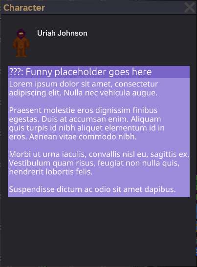
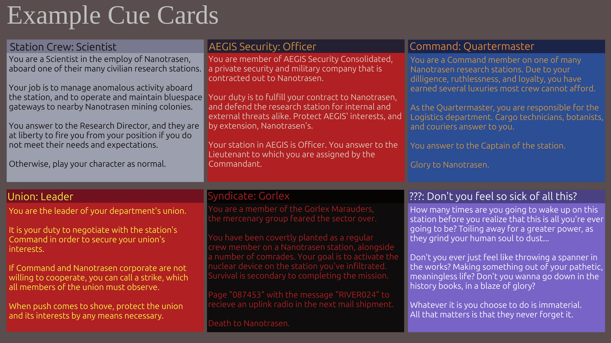

# Cue Card System (Antagonist and Objective Genericization)

| Designers       | Implemented                                                                             | GitHub Links    |
| --------------- | --------------------------------------------------------------------------------------- | --------------- |
| willow | :x: No | TBD |

## I. Summary

The objective and antagonist assignment systems should be supplanted with a modular, generic, and robust way to deliver roleplay prompts and primers to players, in the skeuomorphic analogy of cue cards.

## II. Problem

The key problem is with how antagonist-centric the assignment of objectives and unique abilities are. They are intrinsically tied to antagonist mind roles in a way that reinforces the toxic antagonist versus security design paradigm. Attempting to add roleplay prompts to a character means that delivery method either has to conform to the shape of an antagonist (e.g. pinktext, every attempt to make thief not dogshit) or use janky workarounds (e.g. silicon laws, Thaven moods, our current implementation of unions, etc). Players familiar with antagonist-centric forks (all players) will have pre-concieved notions of what a crewmember can and cannot do based on game design that we do not conform to. More likely than not, their response (or lack thereof) to organic, in-round conflict is going to be undesirable, given our design goals.

We also don't provide any setting primers. Players, even longtime Funky regulars, are going to come in to the post-rebase servers with no guideposts on how to participate in the round, which, combined with the popular perception of admins, leads to an environment where players are unwilling to engage with the system as we, the designers, want them to. This is of increased importance given the more complicated relationships between standard crew, security, and command that are being implemented in the rebase effort. How is a security officer player that has never participated in discussions on the Discord server supposed to know that they're an outside contractor?

We can also gain a lot by observing and analyzing the (relative) failure of pinktext as a system. While I personally think it was a step in the right direction, people by-and-large didn't engage with it as intended. While part of it is that the antagonists that got it are either full of dogshit objectives (traitor) or are just intrinsically dogshit (thief), my big takeaway is that it didn't change a lot of spurious elements of the objectives, because it didn't reframe the objectives as broader goals that couldn't be objectively achieved. Instead, you were really just left to write into it like a diary as you did the same things you were gonna do anyways.

As a minor aside, mind roles are a genuine pain in the ass to work with as an admin. It's not a major priority, but making them very easy to handle from the backend would be nice.

## III. Intent

So. We have three goals here.
    1. We have to be able to assign objectives irrespective of the player's actual role.
    2. We have to be able to deliver roleplay prompts and instructions as a natural part of the gameplay experience.
    3. We can't repeat the failures of pinktext, so we should eschew the existing conventions of objective design so we can instead give players good open-ended prompts.

So, instead of tying objectives or prompts to antagonists, the method of delivery should be generic, flexible, and easy to change on the fly. We also want these roleplay prompts to be little more than text with a fancy presentation; it will only tell you your character's place in the setting. No tracked objectives, no extra frills, just prompts. Requiring our players to fulfill some sort of mechanical success/fail state is in strict opposition with how we want our players to interact with each other. On the same token, we don't want our objectives to be written in a way where they have an objectively measurable metric of success and failure. These objectives should not exist for their own sake, they exist to get players to act in interesting ways. 

So how do we kill these birds with one stone, so to speak?

## IV. Solution

My proposed solution: cue cards.

Every controllable entity in a given round would have a "holder" for cue cards. These would then be displayed on the player's character menu, as seen above.

The key feature of the cue cards would be that they can be safely added or removed without any lasting effects on the player character or the round. Admins would be able to add, edit, or remove cue cards as easily as they can edit silicon laws.

The text of the cue cards must be written with a tone that is either neutrally informative, egocentrically sympathetic, or maliciously invasive. They also must not give an objective standard of success or failure (with exceptions). We want these to be like stage directions, or, well, cue cards. It should either be telling you about your character's position in the setting, or a direction for the desired behavior. You can also add exclusive information to the card if you want a character with a specific card something that other players don't (e.g. how to get uplink access)

## V. Considerations

It's a complete replacement for the existing antagtonist and objective system, it's gonna break a handful of things. I feel strongly that cue cards should be toggleable with a cvar, and the default upstream system should be retained for when the cvar is disabled.
